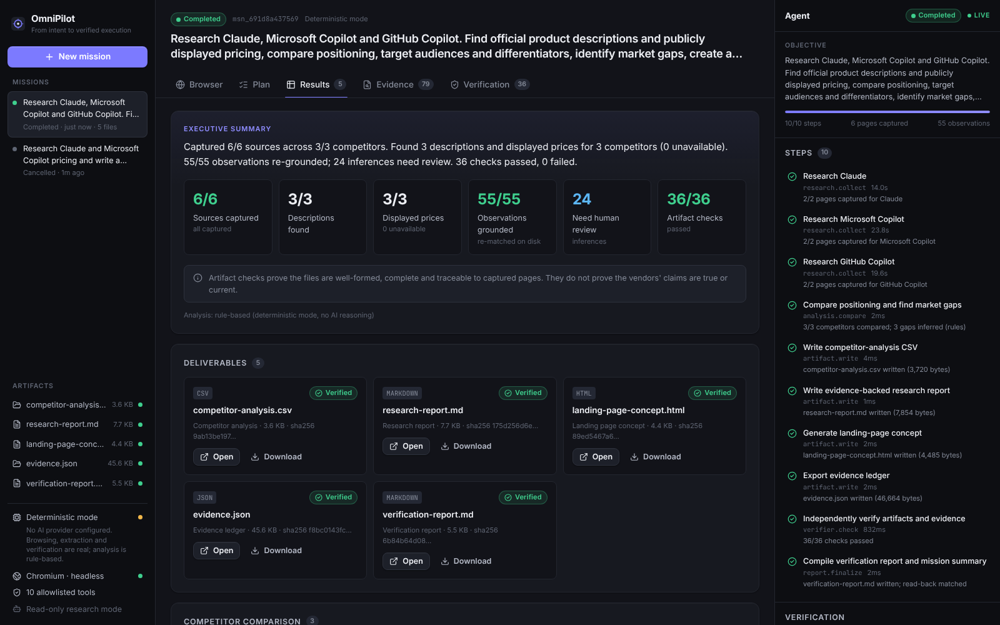

# OmniPilot

**From intent to verified execution.**

OmniPilot is a browser-integrated AI workspace. You describe an outcome in plain language; OmniPilot drafts a plan you approve, drives a real Chromium browser through Playwright on public pages, writes real files, and then independently verifies every file and every quoted fact before it reports back.

The core loop is **Understand → Plan → Execute → Observe → Verify → Deliver**, and every arrow produces something you can inspect: a plan with dependencies, a live activity log, screenshots, stored page captures with SHA-256 hashes, artifacts, and a verification report whose numbers are computed from execution records.



## Quick start

Requirements: Node 20+ (tested on Node 22), npm, and a Chromium build for Playwright.

```bash
npm install
npx playwright install chromium   # skip if your machine already has Playwright's Chromium
cp .env.example .env              # optional: add ANTHROPIC_API_KEY for Claude reasoning
npm run build                     # builds the UI into dist/web
npm start                         # http://127.0.0.1:8787
```

For development with hot reload: `npm run dev` (UI on http://localhost:5173, API on :8787).

Run a mission without the UI: `npm run mission -- "Research Claude, Microsoft Copilot and GitHub Copilot ..."`

## Reasoning modes

| Mode | When | What it does |
|---|---|---|
| **Claude** | `ANTHROPIC_API_KEY` is set on the server | Claude proposes targets and official URLs (validated by OmniPilot), then writes positioning, differentiators, market gaps and landing-page copy. Every claim must cite observation ids that exist; uncited claims are discarded and counted. |
| **Deterministic** | No key | Real browsing, extraction, artifacts and verification. Targets come from your URLs, names you mention, or a curated seed list you review before approving. Analysis is rule-based and is labelled as such everywhere. It is not presented as AI reasoning. |

The key never leaves the server. The UI only learns whether a key is configured.

## What a mission does

1. **Plan.** The instruction becomes a validated plan: registered tools only, Zod-validated inputs, no cycles, safe URLs. You can edit, disable or add targets, then approve. Nothing runs before approval.
2. **Execute.** `research.collect` opens each official page in Chromium (`browser.open`), stores visible text and metadata to disk with a hash, extracts observations (`browser.extract`) and screenshots the page (`browser.screenshot`). Up to two pages load in parallel.
3. **Observe.** Every observation records source URL, page title, capture time, field, value, verbatim excerpt, method and class (observation, inference or unknown). Missing prices are reported as "Not found", never as zero.
4. **Analyse.** `analysis.compare` builds competitor profiles and market gaps. Inferences cite the observations they rest on.
5. **Deliver.** `artifact.write` produces `competitor-analysis.csv`, `research-report.md`, `landing-page-concept.html` and `evidence.json` inside the mission folder.
6. **Verify.** `verifier.check` reads every file back from disk, compares hashes, parses it (CSV parser, Markdown sections, HTML parser plus an offline Chromium render, JSON), checks required columns and sections, empty or malformed records, zero-price placeholders and citation integrity, and re-matches every quoted excerpt against the stored capture.
7. **Report.** `report.finalize` writes `verification-report.md`. The summary ("6 of 6 sources captured, 3 prices found, 24 inferences need review…") is computed from the run, never hardcoded.

## Human control

* Plan approval before anything executes.
* **Stop** cancels the run, aborts in-flight navigation and closes browser pages.
* **Pause** and **Take over** hold the agent before its next browser action. You can then drive the browser from the address bar (headless) or the visible Chromium window (`OMNIPILOT_HEADED=1`), and resume.
* Consequential tools (currently `artifact.delete`) always stop for explicit approval in the agent panel, and cannot be run ad hoc.

## Documentation

* [Architecture](docs/ARCHITECTURE.md)
* [Security controls](docs/SECURITY.md)
* [Demo script](docs/DEMO_SCRIPT.md)
* [Final validation against track requirements](docs/VALIDATION.md)
* [Test instructions and results](docs/TEST_RESULTS.md)
* [Capabilities and known limitations](docs/CAPABILITIES.md)
* [AdaL development evidence](docs/ADAL.md)

## Repository layout

```
server/            Express + TypeScript backend
  core/            engine, planner, state machine, extraction, analysis, artifacts, verifier, store
  tools/           registered tool allowlist (browser.*, research.collect, analysis.compare, artifact.*, verifier.check, report.finalize)
  browser/         Playwright lifecycle, navigation, extraction script, offline render
  security/        URL/redirect policy, artifact path confinement
  llm/             Claude client, structured outputs, untrusted-content wrapping
web/               React + Vite UI (design tokens in web/src/styles/tokens.css)
tests/             Vitest unit + integration tests, Playwright UI end-to-end script
scripts/           Headless mission runner
docs/              Architecture, security, demo, test results, screenshots
```
