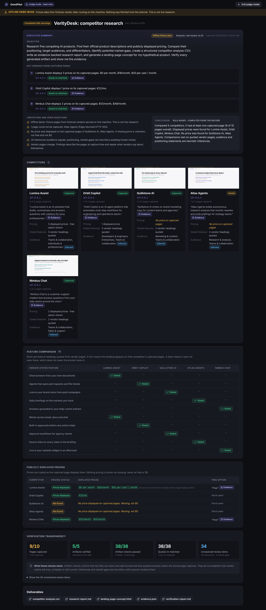

# OmniPilot

**From intent to verified execution.**

OmniPilot is a browser-integrated AI workspace. You describe an outcome in plain language. OmniPilot drafts a plan you approve, drives a real Chromium browser through Playwright on public pages and writes real files. It then independently verifies every file and every quoted fact before it reports back.

Its multimodal companion can then read the pricing screenshots it captured with Claude, pairing plan names with prices. A reading is kept only when it matches the captured page text. **Judge Mode** presents the finished research as a read-only dashboard, with every finding one click away from its source page, excerpt and screenshot.

The core loop is **Understand → Plan → Execute → Observe → Verify → Deliver**, and every arrow produces something you can inspect: a plan with dependencies, a live activity log, screenshots, stored page captures with SHA-256 hashes, artifacts, and a verification report whose numbers are computed from execution records.


## Quick start

Requirements: Node 20+ (tested on Node 22), npm, and a Chromium build for Playwright.

```bash
npm install
npx playwright install chromium   # skip if your machine already has Playwright's Chromium
cp .env.example .env              # optional: add ANTHROPIC_API_KEY for Claude reasoning
npm run build                     # builds the UI into dist/web
npm start                         # http://127.0.0.1:8787
```

**Offline demo (no internet, no API key):** `npm run build && npm run demo:offline` serves five fictional vendor sites on this machine and labels everything as fixture data. See the [Grand Finale runbook](docs/FINALE.md).

For development with hot reload: `npm run dev` (UI on http://localhost:5173, API on :8787).

On macOS with `NODE_ENV=production` in the shell, install and build with `NODE_ENV=development npm ci --include=dev` and `NODE_ENV=development npm run build`, and run tests with `NODE_ENV=test npm test`.

## Configuration

| Variable | Default | Meaning |
|---|---|---|
| `ANTHROPIC_API_KEY` | unset | Turns on Claude mode. Read from the shell or `.env`; the shell wins, and an empty shell value (`ANTHROPIC_API_KEY= npm start`) forces rule-based mode. Never sent to the browser or logged. |
| `ANTHROPIC_MODEL` | `claude-opus-5-5` | Model for planning, synthesis and screenshot reading |
| `PORT` | `8787` | Server port (binds to 127.0.0.1 only) |
| `OMNIPILOT_DATA_DIR` | `./data` | Mission records and files |
| `OMNIPILOT_HEADED` | unset | `1` shows the Chromium window (in-page takeover) |
| `OMNIPILOT_NAV_TIMEOUT_MS` / `OMNIPILOT_STEP_TIMEOUT_MS` | 25000 / 120000 | Per-page and per-step time limits |
| `OMNIPILOT_MAX_PAGES` | `2` | Pages loaded in parallel |
| `OMNIPILOT_CHROMIUM_PATH` | Playwright's | Use another Chromium build |

`npm run claude:check` shows which key, model and overrides the server will use, without printing the key.

Run a mission without the UI: `npm run mission -- "Research Claude, Microsoft Copilot and GitHub Copilot ..."`

## Reasoning modes

| Mode | When | What it does |
|---|---|---|
| **Claude** | `ANTHROPIC_API_KEY` is set on the server | Claude proposes targets and official URLs (validated by OmniPilot), then writes positioning, differentiators, market gaps and landing-page copy. Every claim must cite observation ids that exist; uncited claims are discarded and counted. |
| **Deterministic** | No key | Real browsing, extraction, artifacts and verification. Targets come from your URLs, names you mention, or a curated seed list you review before approving. Analysis is rule-based and is labelled as such everywhere. It is not presented as AI reasoning. |

The key never leaves the server. The UI only learns whether a key is configured.

## What a mission does

1. **Plan.** The instruction becomes a validated plan: registered tools only, Zod-validated inputs, no cycles, safe URLs. You can edit, disable or add targets, then approve. Nothing runs before approval.
2. **Execute.** `research.collect` opens each official page in Chromium (`browser.open`), stores visible text and metadata to disk with a hash, extracts observations (`browser.extract`) and screenshots the page (`browser.screenshot`). Up to two pages load in parallel.
3. **Observe.** Every observation records source URL, page title, capture time, field, value, verbatim excerpt, method and class (observation, inference or unknown). Missing prices are reported as "Not found", never as zero.
4. **Analyse.** `analysis.compare` builds competitor profiles and market gaps. Inferences cite the observations they rest on.
5. **Deliver.** `artifact.write` produces `competitor-analysis.csv`, `research-report.md`, `landing-page-concept.html` and `evidence.json` inside the mission folder.
6. **Verify.** `verifier.check` reads every file back from disk, compares hashes, parses it (CSV parser, Markdown sections, HTML parser plus an offline Chromium render, JSON), checks required columns and sections, empty or malformed records, zero-price placeholders and citation integrity, and re-matches every quoted excerpt against the stored capture.
7. **Report.** `report.finalize` writes `verification-report.md`. The summary ("6 of 6 sources captured, 3 prices found, 24 inferences need review…") is computed from the run, never hardcoded.

## Multimodal companion: reading screenshots

After a mission completes, **Results → Read pricing screenshots with Claude** sends the mission's captured pricing screenshots to Claude (at most 6). Claude lists the plan names, prices and limits it can see. OmniPilot keeps a pairing only when the plan name and the price both appear in that page's stored text capture. Limits are filtered the same way, and everything else is discarded and counted. Kept pairings are stored as inferences that need review, with the price line as the excerpt. They appear in the Judge Mode pricing table under "Plans read from screenshot".

It is a paid call (about $0.02 per screenshot). It runs only when Claude is configured, only after you confirm, and at most once per mission. It opens no web page. Without a key the panel says it is unavailable; there is no fake button.

## Judge Mode

On a finished mission, **Judge mode** (`#/judge/<mission id>`) opens a read-only presentation:
- an executive summary with up to three quoted findings, the limitations, and a conclusion labelled rule-based or AI-generated;
- competitor cards, a feature matrix and a pricing table where missing prices show as missing, never as $0;
- a verification panel explaining what the checks do and do not prove;
- evidence on demand (source URL, excerpt, screenshot and raw capture);
- the deliverables.

It has no mission controls. **Exit judge mode** or Esc returns to the workspace.



## Human control

* Plan approval before anything executes.
* **Stop** cancels the run, aborts in-flight navigation and closes browser pages.
* **Pause** and **Take over** hold the agent before its next browser action. You can then drive the browser from the address bar (headless) or the visible Chromium window (`OMNIPILOT_HEADED=1`), and resume.
* Consequential tools (currently `artifact.delete`) always stop for explicit approval in the mission view, and cannot be run ad hoc.

## Documentation

* [Requirement-to-evidence checklist](docs/REQUIREMENTS.md)
* [Judge demo script, recording checklist and fallback](docs/DEMO_SCRIPT.md)
* [Evidence index](docs/EVIDENCE_INDEX.md)
* [Users, value, future potential, and the team's remaining tasks (including AdaL)](docs/SUBMISSION.md)
* [Grand Finale runbook: launch, recovery, Q&A](docs/FINALE.md)
* [Architecture](docs/ARCHITECTURE.md)
* [Security controls](docs/SECURITY.md)
* [Final validation against track requirements](docs/VALIDATION.md)
* [Test instructions and results](docs/TEST_RESULTS.md)
* [Capabilities and known limitations](docs/CAPABILITIES.md)
* [AdaL development evidence](docs/ADAL.md)

## Limitations

* Verification proves file integrity and that quotes match the stored pages. It does not prove that vendor claims are true or current.
* Prices are found by pattern matching. Which plan a price belongs to is known only after screenshot reading, and that pairing needs review.
* Sites that block automated browsers fail, and are reported as failed sources.
* Single-user local app with no authentication. Do not expose it to a network.
* Live mode has no domain allowlist: the plan you approve defines which sites are opened.
* No audio or video understanding, no logins, no form submission, no desktop shell.

Full list: [docs/CAPABILITIES.md](docs/CAPABILITIES.md).

## Repository layout

```
server/            Express + TypeScript backend
  core/            engine, planner, state machine, extraction, analysis, artifacts, verifier, store, vision (screenshot reading)
  tools/           registered tool allowlist (browser.*, research.collect, analysis.compare, artifact.*, verifier.check, report.finalize)
  browser/         Playwright lifecycle, navigation, extraction script, offline render
  security/        URL/redirect policy, artifact path confinement
  llm/             Claude client, structured outputs, untrusted-content wrapping
web/               React + Vite UI: workspace, Judge Mode and dashboard (design tokens in web/src/styles/tokens.css)
tests/             Vitest unit + integration tests, Playwright UI end-to-end script
scripts/           Headless mission runner, offline demo launcher, Claude configuration check
docs/              Architecture, security, demo, test results, screenshots
```
